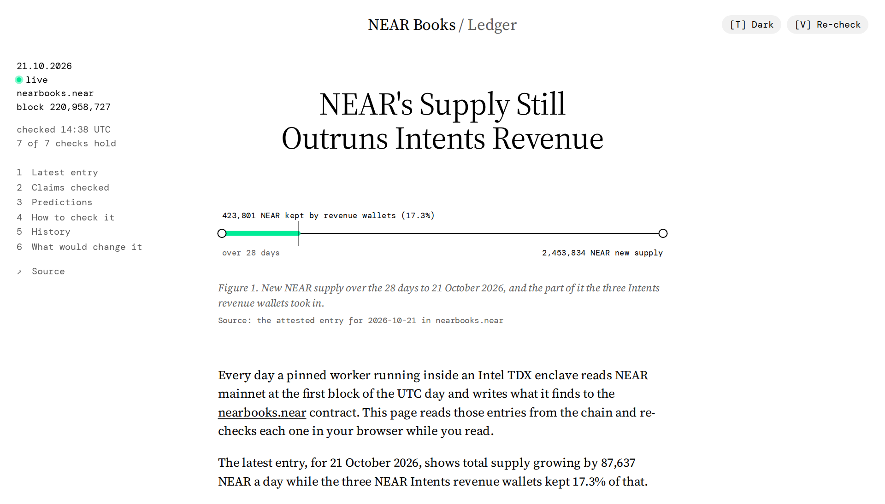

# NEAR Books

An audit of NEAR's token economics that anyone can re-run, plus a TEE-attested daily record of it on mainnet.

**[Dashboard](https://ihormuliar.github.io/nearbooks/)** | contract [`nearbooks.near`](https://nearblocks.io/address/nearbooks.near) | [thesis](THESIS.md) | [claims checked](docs/claims.md) | tracks: Investment Thesis, Open



**Thesis.**
- NEAR Intents earns real and growing revenue, but it does not shrink NEAR's supply. The NEAR it buys back is held, not burned, and the revenue covers about 17% of new supply.
- Holding NEAR today is a bet on Intents growing several times over, not on scarcity.
- Six predictions on chain score this. Two are decided before judging, on 2026-11-05 and 2026-11-15.

<!-- summary:begin (generated by `make readme`) -->
Status: 17/17 findings pass offline (`make verify`). The mainnet contract `nearbooks.near` holds 1 attested snapshot(s) and 6 predictions (6 pending) as of mainnet block 220,955,736; the earlier testnet deployment holds 2 and 7 (1 confirmed, 4 pending, 1 refuted, 1 void). 185 tests (75 Python, 97 contract, 13 worker).
<!-- summary:end -->

## What it does

- **Daily attested record.** A pinned WASM worker runs in OutLayer's Intel TDX enclave. It reads mainnet at the first block of each UTC day and returns the numbers to `nearbooks.near` through yield/resume.
- **An audit you can re-run.** A standard-library Python pipeline rebuilds Intents revenue, buybacks and issuance from committed raw data. It reconciles them with DefiLlama, revenue.near.org and HSP-029.
- **Public claims, graded.** Eight widely shared claims about NEAR's buybacks and issuance are checked against the data. `make verify` fails if a verdict stops following from it.
- **Predictions decided on chain.** Each one is decided only by the attested entry for its date, and anyone can resolve it.
- **Checks in your browser.** The dashboard and an MCP server re-check each entry's worker hash, pin, attestation and transaction.
- **A bounded keeper.** A daily GitHub Action holds a function-call key limited to two methods, and the contract caps what it can spend.

## Verify it

You need `python3` 3.10 or later and `make`. No keys or accounts are required.

**1. Rebuild every finding offline** (about 3 s):

<!-- verify-output:begin (generated by `make readme`) -->
```
$ make verify
...
as_of 2026-10-20: 17/17 findings hold -> ALL PASS
python3 -I pipeline/verify.py data/snapshot-2026-10-20/metrics.json --check-readme README.md
recorded outcomes (mainnet: snapshots 2026-10-21, resolutions none; testnet: snapshots 2026-10-20, 2026-10-21, resolutions 4 confirmed, 5 refuted, 6 void) match the keeper run logs and the cached contract state
README generated blocks match the verified output, no template placeholders left; local builds match contract/deployment.json
```
<!-- verify-output:end -->

**2. Check the attested entry, including its TDX quote** (about 20 s). `--wasm` needs `make worker` first. `--dcap` needs `cargo install dcap-qvl-cli`. Without them the run ends at 13/13 instead of 15/15.

```
$ python3 -I contract/scripts/verify_attestation.py nearbooks.near 2026-10-21 --wasm worker/res/nearbooks-worker.wasm --dcap "$(command -v dcap-qvl)"
snapshot 2026-10-21: nonce 0, OutLayer request 2565, mainnet block 220871336 (ts 1792540800533675965)
...
PASS  quote report_data == sha256(task fields): the quote is bound to this run  7d9db83d…a88b
PASS  quote MRTD+RTMR0-3 are in worker.outlayer.near approved measurements  (66 approved sets)
PASS  Intel DCAP signature chain verifies (dcap-qvl)  TCB status UpToDate
15/15 checks pass
```

**3. Open the dashboard** at https://ihormuliar.github.io/nearbooks/. To run it locally, run `make site` and open http://127.0.0.1:8000/site/.

**4. Run the tests** (`make test`):

<!-- test-output:begin (generated by `make readme`) -->
```
$ make test
Ran 75 tests in ...s
OK
test result: ok. 97 passed; 0 failed; 0 ignored; 0 measured; 0 filtered out   (contract)
test result: ok. 13 passed; 0 failed; 0 ignored; 0 measured; 0 filtered out   (worker)
```
<!-- test-output:end -->

**5. Compare the deployment with the chain** (`make verify-deploy`, about 1 min with Docker). It rebuilds the contract reproducibly and checks the pin, the keeper's scope, and every recorded entry and resolution:

```
$ make verify-deploy CARGO_NEAR=$(command -v cargo-near)
PASS  on-chain code_hash == base58(deployment code_sha256)  7kVhxUa6…hNEh vs 7kVhxUa6…hNEh
PASS  reproducible build of 30d995d == deployed code  644a8df3…2cae (sourcescan/cargo-near:0.21.1-rust-1.96.0@sha256:ccb22bb4…ee17)
PASS  attested snapshot 2026-10-21 on chain == record  mainnet block 220871336, OutLayer request 2565, tx 8K3s7mq3…34Yg stored it, signed by the keeper function-call key
...
```

Full outputs are in [`docs/deployment.md`](docs/deployment.md) and [`docs/attestation.md`](docs/attestation.md).

## Findings

<!-- key-findings:begin (generated by `make readme`) -->
| ID | Finding | Number | How it is checked | Check |
|---|---|---|---|---|
| F1a | Intents revenue 2026-01-01..2026-10-19, rebuilt from raw transfers, matches DefiLlama | $7,518,638 vs $7,561,260 (-0.56%) | daily native-NEAR inflows to the 3 revenue wallets (FastNear); tolerance +-0.92% (2 standard errors) | PASS |
| F2a | The buyback wallet's balance is fully explained by its transfers and fees | 2,024,301.607 NEAR, 0 yoctoNEAR unexplained | integer sums over 2,732 FastNear rows vs the archival RPC balance | PASS |
| F2b | Total supply rose in every sampled interval of 2026 (no net burn visible) | 42/42 sampled intervals up, +1.99% | archival RPC block headers | PASS |
| F2c | Share of revenue DefiLlama labels 'buyback' that reached the buyback wallet | 69.0% (DefiLlama implies 100%) | wallet inflows since 2026-02-23 vs DefiLlama dailyHoldersRevenue | PASS |
| F2f | The 2.02M vs 1.51M NEAR gap Altcoin Buzz could not explain | 505,085.6 NEAR gap, decomposition closes to -0.026 NEAR | internal transfer - outflows - fees + revenue after the dashboard cutoff; published figures pinned in config.json | PASS |
| F3a, F3b | HSP-029's treasury share and realised issuance reproduce | 10.147% vs 10.13%; 2.444%/yr vs 2.45%/yr | archival RPC supply and treasury.near balance, 7/28/92-day windows | PASS |
| F4a, F4b | Daily volume at which buybacks would offset issuance if burned, vs current volume | $795M/day = 5.3x current; 3.4x at 1.6% issuance (end of the HSP-029 ramp) | DefiLlama volume, on-chain take rate and issuance; worst-case price and take rate still give 4.5x | PASS |
| F6a | Share of transactions that are meta-transactions (NEP-366 Delegate) | 85.4% (2026-01) -> 36.4% (2026-09) | seeded 360-block NEARData sample; the two 95% intervals do not overlap | PASS |
<!-- key-findings:end -->

All findings, with tolerances and sources, are in [`docs/findings.md`](docs/findings.md).

## How it works

```
 NEAR mainnet ── archival RPC ──> OutLayer TDX worker (sha256 pinned in the contract)
                                     │ output via yield/resume
 keeper or anyone ─────────────> nearbooks.near
                                     ├─ one attested entry per UTC day
                                     ├─ predictions, decided only by the entry of their date
                                     └─ worker pin, re-pins timelocked
 attestation (TDX quote) ──> verify_attestation.py, dashboard, MCP server

 FastNear, DefiLlama, archival RPC ──> pipeline/fetch*.py ──> data/ ──> compute.py ──> verify.py
```

1. For UTC date D, the keeper or anyone else asks the contract for an entry.
2. The contract has OutLayer run the worker pinned for D. A re-pin waits 24 hours and never applies to a date that has started.
3. The worker reads total supply, the three Intents revenue wallets and an `intents.near` reserves check, at the first block of D and of D minus 28 days.
4. The contract stores the output under D. A prediction is decided only by the entry for its date.

## Limits

- The contract account still holds its full-access key, so the code can still change. The key will be deleted before submission; `make verify-deploy` lists the account's keys.
- The contract does not check the TDX quote; `verify_attestation.py` does.
- The worker reads mainnet over JSON-RPC, without state proofs. The evidence hash commits to the raw responses.
- F1 is not independent of DefiLlama, because both sum the same wallets.
- Published figures were typed in by hand, with their sources, in `pipeline/config.json` and `pipeline/claims.json`.

More limits are in [`docs/findings.md`](docs/findings.md#limits-of-the-pipeline).

## Layout

```
pipeline/   fetch, compute and verify; config.json, claims.json, predictions.json
data/       committed raw inputs (snapshot 2026-10-20)
contract/   the NEAR contract (src/), deployment records, logs/, scripts/
worker/     the TEE worker (WASM)
keeper/     the daily keeper
mcp/        MCP server over stdio
site/       the dashboard: one static file, no build step
docs/       findings, claims, attestation, deployment
tests/      Python tests and a headless browser check
```

To add the MCP server to Claude Code: `claude mcp add nearbooks -- python3 /path/to/nearbooks/mcp/server.py`.

## License

MIT
